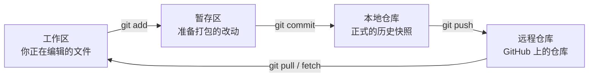

> 难度：★☆☆　预计耗时：45 分钟
> 本章目标：搞懂 Git 到底在管什么——工作区、暂存区、版本库三层结构，并掌握每天真正会用的十几个命令。学完这章，你就敢放心大胆地改代码了，因为随时能"反悔"。

---

## 一、Git 到底是干什么的

一句话：**Git 是给代码拍快照的照相机。**

没有 Git 的世界：

- 存档方式是 `项目-final.zip`、`项目-final-真的final.zip`、`项目-改完这个就下班.zip`
- 同事之间传文件靠聊天窗口，谁改了哪一行全靠记忆
- 改坏了想回退？对不起，只能回忆昨天晚上改了什么

有 Git 的世界：

- 每次提交（commit）都是一次完整快照，**随时回到任何一个历史时刻**
- 每个改动都有作者、时间、说明，出问题能追溯到人
- 多人同时改同一个项目，Git 帮你合并，不用再传 zip 包

> 本系列教程配合 GitHub 上的练习仓库 [git-practice](https://github.com/yuxiangming/git-practice) 使用，每一章都建议动手敲一遍。

---

## 二、原理图解：三个区，一条流水线

Git 的核心模型就三个区，所有命令都是在这三个区之间搬东西：



用快递打个比方：

- **工作区**：你在家里拆散准备发货的东西
- **暂存区**（staging）：打包好的纸箱——你可以决定这次装哪些，下次装哪些
- **本地仓库**：已经发出、登记在你家历史记录里的包裹
- **远程仓库**（GitHub）：公司的总仓库，所有人都从这里取货、往这里发货

**为什么要有暂存区？** 因为一次提交应该是"一个完整、有主题的改动"。比如你同时改了"登录 bug"和"新页面"，就可以先把登录相关文件 `add` 进暂存区提交一次，再把新页面 `add` 进去提交第二次。历史清清楚楚。

---

## 三、安装与首次配置

### 1. 安装

- **Windows**：去 [git-scm.com](https://git-scm.com/download/win) 下载，一路默认下一步即可
- **macOS**：`brew install git`
- **Linux**：`sudo apt install git`

### 2. 安装后必做的两行配置（身份标识）

```bash
# 配置用户名和邮箱——会出现在你每一次提交记录里
git config --global user.name "你的名字"
git config --global user.email "你的邮箱@example.com"

# 查看当前配置
git config --list
```

> 邮箱建议用 GitHub 绑定的邮箱，这样 GitHub 上的提交会自动关联到你的头像和账号。

---

## 四、日常高频命令（先背这 12 个）

下面这些命令覆盖了日常 95% 的场景。演示用练习仓库 `git-practice`：

### 1. 把仓库拿下来：clone

```bash
# 克隆 GitHub 上的练习仓库到本地
git clone https://github.com/yuxiangming/git-practice.git

cd git-practice
```

### 2. 随时看状态：status（用得最多的命令，没有之一）

```bash
git status
```

输出会明确告诉你：哪些文件改了但没暂存、哪些已暂存待提交、哪些没被 Git 管理。**迷茫的时候就敲一下 `git status`。**

### 3. 保存改动三连：add → commit → push

```bash
# 修改了 hello.txt 之后：

git add hello.txt          # 单个文件放进暂存区
git add .                  # 当前目录所有改动放进暂存区（常用）

git commit -m "feat: 第一次练习提交"   # 打包成一次快照，-m 后面是说明

git push                   # 推送到 GitHub
```

> 提交说明怎么写：`feat:` 新功能、`fix:` 修 bug、`docs:` 文档、`test:` 测试。别再写 `update`、`111` 了。

### 4. 看历史：log

```bash
git log                    # 完整历史
git log --oneline          # 一行一条，清爽版
git log --oneline --graph --all   # 带分支图，看合并最直观
```

### 5. 看改了什么：diff

```bash
git diff                   # 工作区 vs 暂存区：这次还没 add 的改动
git diff --staged          # 暂存区 vs 上次提交：即将 commit 的内容
```

### 6. 撤销与后悔药

```bash
# 情况一：改乱了某个文件，想恢复到上次提交的样子（未 add）
git restore hello.txt

# 情况二：已经 add 了，想把它移出暂存区
git restore --staged hello.txt

# 情况三：想改最近一次提交的说明（还没 push）
git commit --amend -m "feat: 更正后的提交说明"

# 情况四：回退到上一个提交（小心：会丢掉未提交的改动）
git reset --hard HEAD~1
```

> `reset --hard` 是"真后悔药"，**未提交的改动会被直接丢掉**，不可恢复。用之前先确认 `git status` 里没有你舍不得的东西。

### 7. 临时存一下：stash

场景：写到一半，突然要切到别的分支修紧急 bug，代码还不完整不能提交。

```bash
git stash          # 把当前未完成的改动"塞抽屉里"
git stash list     # 看抽屉里有几个包裹
git stash pop      # 干完别的事回来，把包裹拿出来继续
```

---

## 五、.gitignore：有些文件不该进仓库

编译产物、密钥、`node_modules` 这些东西不应该被提交。在仓库根目录建一个 `.gitignore` 文件：

```gitignore
# 依赖目录
node_modules/

# 构建产物
dist/
build/

# 日志与本地环境变量
*.log
.env

# 编辑器配置
.idea/
.vscode/
```

> 注意：`.gitignore` 只对**还没被跟踪**的文件生效。如果文件已经提交过，先 `git rm --cached 文件名` 把它移出跟踪，再写进 `.gitignore`。

---

## 六、常见坑

**坑一：`git add .` 把 500MB 的压缩包提交了。**
GitHub 单文件限制 100MB，推不上去还删不掉历史。解决：提交前先 `git status` 检查，配上 `.gitignore`。

**坑二：中文文件名显示成乱码。**
Windows 下执行 `git config --global core.quotepath false` 即可正常显示中文。

**坑三：commit 了才发现说明写错。**
还没 push：`git commit --amend -m "新说明"`。已经 push：`amend` 之后 push 会冲突，可以不改，历史记录里错一个字不致命。

**坑四：reset --hard 之后追悔莫及。**
只要提交过，就有救：`git reflog` 能看到所有历史操作记录，找到那次的哈希值，`git reset --hard 哈希值` 回去。

---

## 七、本章小结

| 命令 | 一句话记忆 |
|---|---|
| `git clone` | 把远程仓库整个搬下来 |
| `git status` | 我现在是什么状态（迷茫就敲它） |
| `git add` | 改动放进暂存区（打包） |
| `git commit` | 打包完成，存一条历史快照 |
| `git push` | 上传到 GitHub |
| `git pull` | 下载最新代码到本地 |
| `git log --oneline` | 看历史，一行一条 |
| `git diff` | 看具体改了哪几行 |
| `git restore` | 撤销工作区改动 |
| `git stash` | 改到一半暂时塞抽屉 |

下一章：**分支入门**——Git 最强大的功能，也是多人协作的地基。

---

## 八、练习清单

- [ ] 安装 Git 并完成用户名、邮箱配置
- [ ] 克隆练习仓库 git-practice
- [ ] 完成一次完整流程：改文件 → add → commit → push
- [ ] 用 `git log --oneline` 找到自己的提交
- [ ] 写一个 `.gitignore`，故意改错一个文件再 `git restore` 恢复它
- [ ] 用 `git stash` 体验"塞抽屉再拿出来"
