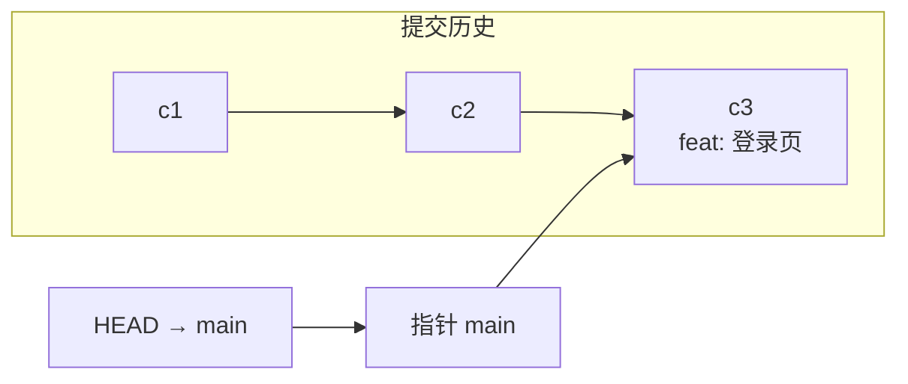

> 难度：★☆☆　预计耗时：40 分钟
> 本章目标：理解分支的本质（一个可移动的指针），掌握创建、切换、合并、删除分支的全套命令。学完这章，你就敢开分支写实验性代码了——反正搞砸了，主分支毫发无损。

---

## 一、为什么需要分支

没有分支的多人开发是灾难：五个人往 `main` 上提交，A 改崩了登录，B 的提交也跟着完蛋。

有了分支，世界变成这样：

- `main` 分支：永远是能用的稳定版本
- 每个人/每个功能各开一条分支：随便折腾，不影响别人
- 写完、测好了，再把分支"合"回主分支

**分支 = 平行宇宙。** 你在某条分支上做的一切，别的分支完全感知不到；哪天想通了，再把两个宇宙合并回来。

## 二、原理图解：分支只是一个指针

这是理解分支最重要的一张图。很多人被"分支"吓住，其实它的实现简单得惊人：



- Git 里每次提交都是一个快照对象，提交串成一条链
- **分支只是一个指向某个提交的指针**（一个 41 字节的小文件），创建分支几乎零成本
- `HEAD` 是"你当前站在哪个分支"的标记，Git 就把新提交接到 HEAD 指向的分支上

所以"新建分支"不是复制整个项目，只是新建了一个指针——这就是为什么 Git 的分支比某些工具"轻"得多。

## 三、核心命令演示

在练习仓库 git-practice 里跟着敲：

### 1. 看分支

```bash
git branch        # 列出本地分支，当前分支带 * 号
git branch -r     # 列出远程分支
git branch -a     # 全都列出来
```

### 2. 创建与切换

```bash
# 方式一：两步走
git branch dev            # 创建 dev 分支
git checkout dev          # 切换到 dev（HEAD 指向 dev）

# 方式二：一步到位（推荐）
git checkout -b dev       # 创建并切换

# 方式三：新语法，含义更直白（switch 只管切换，checkout 兼管撤销）
git switch -c dev         # 创建并切换
git switch main           # 切回 main
```

### 3. 在分支上开发并提交

```bash
git switch -c feature/hello
echo "hello from branch" > hello.txt
git add hello.txt
git commit -m "feat: 在分支上添加 hello"

# 此时切回 main，会发现 hello.txt 不存在——平行宇宙互不干扰
git switch main
ls

# 切回来，文件又出现了
git switch feature/hello
```

### 4. 删除分支

```bash
git branch -d feature/hello      # 安全删除（未合并会拒绝）
git branch -D feature/hello      # 强制删除（确认不要了才用）
```

> 删除分支只是删指针，上面的提交如果已经合并，依然安全地待在主线上。所以"合并完就删分支"是标准习惯。

### 5. 远程分支

```bash
# 把本地分支推到 GitHub，并建立跟踪关系
git push -u origin feature/hello
# -u 以后这个分支直接 git push 就行，不用再写全名

# 拉取远程新建的分支
git fetch origin
git switch feature/other       # 新版 Git 会自动跟踪对应的远程分支
```

## 四、分支命名规范

命名不是摆设，一套好名字让别人（和三个月后的你）一眼看懂这条分支是干嘛的：

| 前缀 | 用途 | 示例 |
|---|---|---|
| `feature/` | 新功能开发 | `feature/user-login` |
| `fix/` 或 `hotfix/` | 修 bug | `fix/payment-crash` |
| `release/` | 发布准备 | `release/v1.2.0` |
| `test/` | 测试专用 | `test/ci-pipeline` |

规则：小写、用短横线分隔、写清楚是"什么"而不是"什么时候"（`fix/login` 好过 `fix/1103`）。

## 五、常见坑

**坑一：在错误的分支上写了一堆代码。**
还没提交：`git stash` → 切到正确分支 → `git stash pop`。
已经提交了：在正确分支 `git cherry-pick 提交哈希` 把提交"摘"过来，再用 `git branch -D` 清理原分支。

**坑二：新分支忘推远程，电脑坏了代码全丢。**
本地分支只存在于你的电脑。新分支建好就 `git push -u origin 分支名`，养成习惯。

**坑三：`checkout 文件名` 和 `checkout 分支名` 撞脸。**
同一个命令两种含义容易误伤文件。建议切换分支统一用新命令 `git switch`，撤销文件用 `git restore`，语义清晰不打架。

## 六、本章小结

| 命令 | 一句话记忆 |
|---|---|
| `git branch` | 看分支（带 `-a` 看远程） |
| `git switch -c 名字` | 创建并进入新分支 |
| `git switch 名字` | 切换分支 |
| `git branch -d 名字` | 删除已合并的分支 |
| `git push -u origin 名字` | 推送新分支并建立跟踪 |
| `git cherry-pick 哈希` | 把某个提交摘到当前分支 |

下一章：**分支合并的两种方式**——`merge` 和 `rebase`，一次讲透。

---

## 七、练习清单

- [ ] 在练习仓库创建 `feature/first-branch` 并推送远程
- [ ] 在新分支上提交一次改动，切回 main 验证改动"消失"了
- [ ] 删除该分支，并用 `git branch -a` 确认
- [ ] 故意提交一次，然后 `git cherry-pick` 到另一个分支
