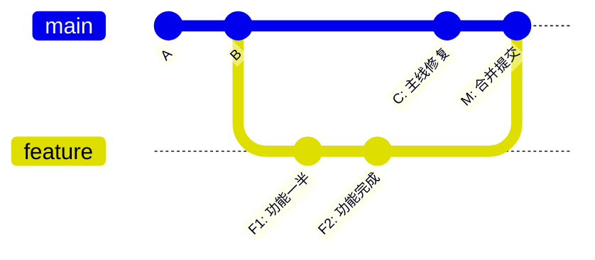
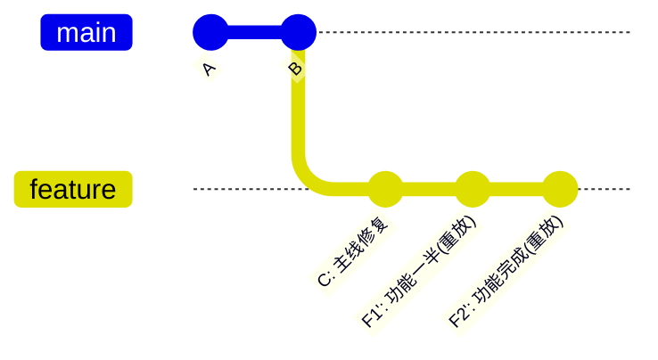

> 难度：★★☆　预计耗时：60 分钟
> 本章目标：一次讲透合并分支的两种方式——merge（把历史连起来）和 rebase（把历史搬个家）。搞懂它们的区别、冲突怎么解、各自适合什么场景。这是 Git 面试必考题，也是团队协作最容易翻车的地方。

---

## 一、为什么合并是 Git 的"重头戏"

分支平行宇宙最终要合回主宇宙。但合并历史有两种思路，会得到两种完全不同的提交历史：

- **merge**：老老实实把两条历史线都保留，再打一个"合并结"
- **rebase**：把我的提交"搬家"，搬到你的历史线顶上重来一遍

同样的两次开发，merge 之后历史是"编辫子"，rebase 之后历史是"一条直线"。没有绝对的对错，只有场景的选择。

## 二、方式一：git merge（默认方式）

### 原理：找一个共同祖先，把两边合并

假设 main 上有提交 A、B，然后开了 feature 分支，两边各自前进：



合并时 Git 找到两边最近的共同祖先（B），做一次三方比较，然后生成一个**合并提交（merge commit）M**——它有两个父提交，代表"这两条线在这里汇合了"。

```bash
git switch main
git merge feature
```

merge 时 Git 会自动选一句话作为合并说明，也可以 `-m` 自己写：

```bash
git merge feature -m "merge: 合并登录功能"
```

### 特点总结

- ✅ 完整保留真实历史：谁在什么时候、哪条线上做了什么，一目了然
- ✅ 安全、不打乱任何已有提交
- ❌ 历史图呈网状/辫子状，提交多了看着晕
- ❌ 多一个"只为合并而存在"的提交

## 三、方式二：git rebase（变基）

### 原理：把我的提交摘下来，接到别人历史的顶上

`git rebase main` 的字面意思是"以 main 为新的基底，重新铺我的提交"：



rebase 的过程：

1. 找到 feature 和 main 的共同祖先，把 feature 上的提交（F1、F2）暂时"摘下来"
2. 把 main 最新的提交（C）接到前面
3. 把摘下来的提交**逐个重新应用**到 C 后面——生成内容相同、但哈希不同的新提交（F1'、F2'）

```bash
git switch feature
git rebase main          # 把 feature 的提交搬到 main 顶上

# 变基后 feature 包含 main 的全部历史，合并变成"快进"，不会再有合并提交
git switch main
git merge feature
```

最后一步的 merge 因为历史已经是直线，Git 直接把 main 指针往前挪（fast-forward），不产生合并提交。

### 特点总结

- ✅ 历史是一条直线，干干净净，`git log` 像读故事一样
- ✅ 没有多余的合并提交
- ❌ **改写了历史**：F2 变成了 F2'，哈希都变了
- ❌ 对已推送远程的分支 rebase，会造成团队的"历史错乱"（详见后文大坑）

## 四、两种方式对比一览

| 维度 | merge | rebase |
|---|---|---|
| 历史形状 | 辫子状（多线并行） | 一条直线 |
| 是否产生合并提交 | 是 | 否（配合 fast-forward） |
| 是否改写已有提交 | 否 | 是（重新生成） |
| 历史真实性 | 完全真实 | 被"美化"过 |
| 适合场景 | 公共分支、保留过程记录 | 个人分支拉平、PR 前整理 |
| 风险 | 低 | 对共享分支 rebase = 灾难 |

**一句话选择法：**

> **合并到公共分支（main、develop）用 merge；拉平自己的私有分支用 rebase。**

## 五、冲突：两边改了同一处怎么办

无论 merge 还是 rebase，只要两边改了同一个文件的同一处，Git 就不敢自作主张，停下来让你裁决：

```bash
<<<<<<< HEAD
价格：99 元            # 当前分支（合并目标）的内容
=======
价格：199 元           # 被合进来的分支的内容
>>>>>>> feature/price
```

解决三步走：

```bash
# 1. git status 找到冲突文件，打开它，把 <<<<<<< ===== >>>>>>> 手工删掉，
#    保留你想要的版本（或融合两者）

# 2. 标记冲突已解决
git add 冲突文件

# 3. 结束合并
git commit            # merge 场景：提交合并结果
git rebase --continue # rebase 场景：继续变基下一个提交
```

后悔药：

```bash
git merge --abort        # 放弃这次 merge，回到合并前
git rebase --abort       # 放弃这次 rebase，回到变基前
```

> **避免冲突的习惯**：小步提交、勤拉主线（rebase main 别拖一周）、一个功能分支只干一件事。

## 六、团队里最常见的实战节奏

```bash
# 每天开工第一件事：把 main 拉平到自己的分支（避免越落后冲突越多）
git switch feature/login
git fetch origin
git rebase origin/main

# 功能写完，推远程、发 PR
git push -u origin feature/login
# → 在 GitHub 上发起 Pull Request，同事 review 后合入 main

# 合入后删本地分支
git switch main && git pull
git branch -d feature/login
```

## 七、最大的坑：rebase 公共分支

**场景**：同事把 `feature/login` 推到了远程，大家都在看。你本地 `rebase main` 之后 `push`——历史被改写，你的哈希和远程对不上，强推之后**同事本地的历史全乱了**，轻则一堆冲突，重则提交丢失。

三条铁律：

1. **别人可能正在用的分支，永远不要 rebase**
2. rebase 后确实需要覆盖远程：用 `git push --force-with-lease`（比 `--force` 安全，远程有别人新提交时会拒绝），并且**先在群里喊一声**
3. 拿不准就用 merge——它永远不会错，只是历史丑一点

## 八、本章小结

- `git merge 分支`：老实合并，历史辫子状，安全
- `git rebase 分支`：搬家重铺，历史直线，好看但要小心
- 冲突解决：改文件 → `git add` → `git commit` / `git rebase --continue`
- `git merge --abort` / `git rebase --abort` 是后悔药
- 公共分支 merge，私有分支 rebase，永远不要 rebase 共享分支

## 九、练习清单

- [ ] 在练习仓库复现本章图：main 和 feature 各提交一次，然后 `git merge`
- [ ] 用 `git log --oneline --graph --all` 观察辫子状历史
- [ ] 制造一次冲突（两边改同一行），手工解决并提交
- [ ] 新开分支体验 `git rebase main`，对比 rebase 前后 `git log` 的形状
- [ ] 用 `--force-with-lease` 场景复述一遍：为什么强推共享分支是大坑
