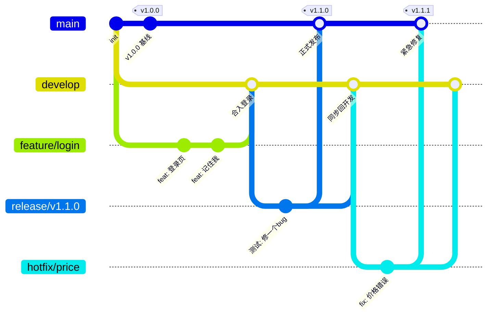

> 难度：★★☆　预计耗时：50 分钟
> 本章目标：讲清团队协作里最常见的分支分配方案——main 主版本、develop 开发版本、release 测试版本、feature 功能分支、hotfix 紧急修复。看完这章，你能回答：代码现在到底处于"哪条流水线的哪个环节"。

---

## 一、为什么分支要"分工"

上一章学会了合并，但真正上线一个项目，还有新问题：

- 用户在用的版本，和新开发的功能，必须**隔离开**
- 测试环境测的是"下周要发布"的代码，不是"还在写"的代码
- 线上半夜炸了，要有一套**不打扰正在进行的开发**的救火通道

这些问题的答案就是：**给每条分支一个明确的角色，规定它跟谁合并、往哪发。**

## 二、原理图解：Git Flow 主干模型

最经典的分支分配方案是 Git Flow，一张图看懂所有分支的分工：



## 三、五种角色逐一拆解

### 1. main（主版本 / 生产版本）

- **角色**：线上正在运行的稳定代码，永远是"能发布"的状态
- **规则**：只接受 release/hotfix 的合并，直接往 main push 通常被禁止（保护分支）；每次合并到这里打一个版本 Tag（如 `v1.2.0`）
- **CI 对应**：推送 main 或打 Tag → 触发生产部署流水线

### 2. develop（开发版本）

- **角色**：日常开发的集散地，最新的功能都在这里汇合，状态是"下一个版本的候选"
- **规则**：feature 分支写完合并到这里；它自己**永不直接推生产**
- **CI 对应**：推 develop → 部署到开发/联调环境，跑自动化测试

### 3. release（测试版本 / 发布分支）

- **角色**：版本发布的"候考场"。从 develop 分出，冻结新功能，只做测试、修小 bug，直到验收通过
- **命名**：`release/v1.2.0`
- **流向（双向）**：
  - 验收通过 → 合入 **main** 并打 Tag → 生产发布
  - 测试中修的 bug → 同时合回 **develop**，防止修复"丢"在 release 上
- **CI 对应**：推 release/* → 部署到测试/预发布环境

### 4. feature（功能分支）

- **角色**：一个新功能一条分支，从 develop 分出，开发完合回 develop
- **命名**：`feature/功能名`，如 `feature/order-export`
- **生命周期**：短平快，合并完就删

### 5. hotfix（紧急修复分支）

- **角色**：线上半夜炸了，来不及走完整流程，从 **main** 直接分出，修完合回 **main**（打新 Tag）并同步回 **develop**
- **命名**：`hotfix/问题名`，如 `hotfix/payment-crash`

### 一张表记住全部规则

| 分支 | 从哪分出 | 合回哪里 | 环境 | 生命周期 |
|---|---|---|---|---|
| `main` | — | — | 生产 | 永久 |
| `develop` | main | — | 开发/联调 | 永久 |
| `release/vX.Y.Z` | develop | main + develop | 测试/预发 | 发布后删 |
| `feature/xxx` | develop | develop | 本地 | 合并完就删 |
| `hotfix/xxx` | main | main + develop | 生产 | 合并完就删 |

## 四、版本号也要会读：语义化版本

分支和 Tag 常配 Semantic Versioning（语义化版本）：

```
v 主版本 . 次版本 . 修订号
  1   .   2   .   1
```

- **主版本**（major）：不兼容的大改，升 `v1.2.1 → v2.0.0`
- **次版本**（minor）：向后兼容的新功能，升 `v1.2.1 → v1.3.0`
- **修订号**（patch）：只修 bug，升 `v1.2.1 → v1.2.2`

对照分支：功能持续合入 develop → 攒够一个次版本，开 `release/v1.3.0` → 测试通过合 main 打 Tag → 线上出 bug 走 hotfix 出 `v1.3.1`。

## 五、命令实战：走一遍完整发布流程

```bash
# 1. 从 develop 开出功能分支，开发登录
git switch develop && git pull
git switch -c feature/login
# ...开发、提交...
git switch develop
git merge feature/login           # 团队约定功能合回 develop 用 merge
git branch -d feature/login
git push origin develop           # CI 自动部署到开发环境

# 2. 版本冻结，开测试分支
git switch -c release/v1.3.0
git push -u origin release/v1.3.0 # CI 自动部署到测试环境

# 3. 测试发现小 bug，在 release 上修
git switch release/v1.3.0
# ...修复、提交...

# 4. 验收通过，发布
git switch main
git merge release/v1.3.0 -m "release: v1.3.0"
git tag v1.3.0                    # 打 Tag，触发生产发布
git push origin main --tags

# 5. 把测试期间的修复同步回 develop
git switch develop
git merge release/v1.3.0
git push origin develop

# 6. 收尾：删掉 release 分支
git branch -d release/v1.3.0
git push origin --delete release/v1.3.0
```

**hotfix 通道**（生产炸了）：

```bash
git switch main && git switch -c hotfix/price-crash
# ...修复、测试...
git switch main && git merge hotfix/price-crash
git tag v1.3.1 && git push origin main --tags
git switch develop && git merge hotfix/price-crash   # 修复同步回开发
git branch -d hotfix/price-crash
```

## 六、简化版：小团队用 GitHub Flow

Git Flow 很完备，但对两三人的团队和持续部署的 Web 项目偏重。更轻量的 **GitHub Flow** 只有一条 main：

1. 从 main 开 feature 分支
2. 小步提交，开 Pull Request
3. CI 自动跑测试，review 通过 → 合入 main
4. main 一有新提交就自动部署（测试由 PR 阶段的预发环境保证）

**怎么选**：

| 团队 | 推荐方案 |
|---|---|
| 版本化发布、有明确测试/生产环境区分（App、传统企业项目） | Git Flow（本章模型） |
| Web 服务、小团队、持续部署 | GitHub Flow / trunk-based |

两种模型里 main 的角色不变，差的只是"发布候考"环节是否单独立分支。

## 七、常见坑

**坑一：feature 在 develop 上跑了三天才发现 develop 落后 main 一大截。**
养成 `git fetch` + `git log HEAD..origin/develop --oneline` 每天看一眼的习惯，落后太多先 rebase/merge 对齐。

**坑二：release 上修的 bug 忘了合回 develop。**
下个版本把同一个 bug 又"复活"了。规范写清楚：release 的修复必须双向同步。

**坑三：Tag 打了又删又重打。**
Tag 是生产运行的"身份证"，重打等于让回滚回到不存在的版本。打错就出下一个修订号，绝不重打。

**坑四：hotfix 只合进了 main。**
修了线上，develop 里的老 bug 还在，下个版本带着它上线。hotfix 必须 main、develop 双向合并。

## 八、本章小结

- main = 生产；develop = 开发集散地；release = 发布候考场（测试版本）；feature = 功能车间；hotfix = 救火通道
- release 修复要双向同步（main + develop），hotfix 同理
- 版本号：主版本.次版本.修订号，Tag 只增不改
- 小团队可以简化为 GitHub Flow：main + feature + PR

下一章：**GitHub 实战**——创建一个练习仓库，把这三章的功夫全部落地打一遍。

## 九、练习清单

- [ ] 在练习仓库建出 develop 分支
- [ ] 走通一遍：feature → develop → release → main → Tag
- [ ] 故意模拟一次 hotfix：从 main 分出、修复、合回 main 和 develop
- [ ] 用 `git log --oneline --graph --all` 看你的"发布历史"，是不是和本章开头的图很像
